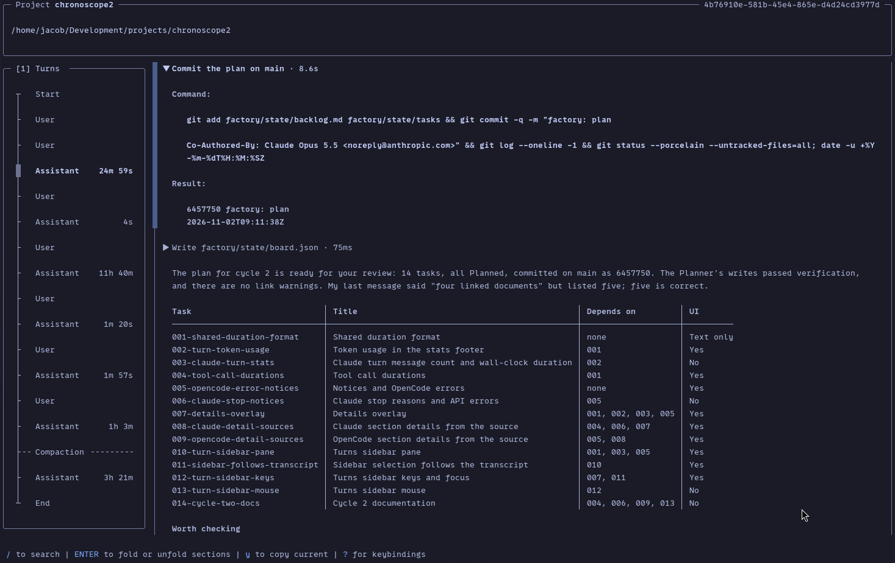
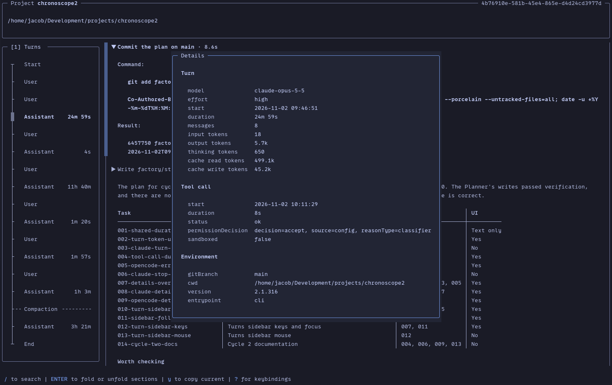
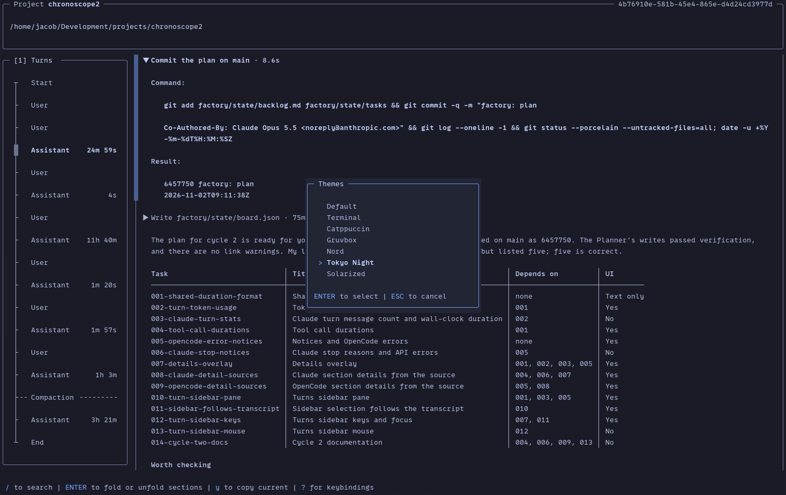

# Chronoscope

Chronoscope is a read-only terminal viewer for session histories of AI coding agents. It lists 
the sessions of your local projects, and presents them as a transcript of turns that you can 
fold, search, copy, save and export, with live updates while the session is still running.

You can export individual sections or the entire transcript as a Markdown document, view details about token usage and tool use in individual turns, or re-open the selected transcript in your harness. 








## Install

### From a release

Download the archive for your platform from the
GitHub releases page of this project, unpack it and put the `chronoscope`
binary somewhere on your `PATH`. Release builds exist for:

| Platform | Target |
|---|---|
| Linux, x86_64 | `x86_64-unknown-linux-gnu` |
| macOS, Apple silicon | `aarch64-apple-darwin` |
| macOS, Intel | `x86_64-apple-darwin` |

The Linux build is also published as `.deb` and `.rpm` packages, which you
install with your package manager:

```sh
sudo apt install ./chronoscope_<version>-1_amd64.deb
sudo dnf install ./chronoscope-<version>-1.x86_64.rpm
```

Linux is the primary platform. macOS is built and tested in CI. Windows is not
officially supported but you should be able to build the tool for the platform.

### From source

You need a Rust toolchain (1.88 or newer).

```sh
git clone <this repository>
cd <the clone>
cargo install --path .
```

### As a package built from source

To build the `.rpm` and `.deb` packages yourself:

```sh
cargo install --locked cargo-deb cargo-generate-rpm
scripts/package.sh
sudo dnf install ./target/generate-rpm/chronoscope-<version>-1.x86_64.rpm
```

The `.deb` is in `target/debian/`. Build it on Debian or Ubuntu: elsewhere its
dependencies are left out, because working them out needs `dpkg-shlibdeps`.

The packages install to `/usr/bin`. A copy from `cargo install` in
`~/.cargo/bin` usually comes first on your `PATH`, so remove it with
`cargo uninstall chronoscope`.

## Usage

```
chronoscope                          # selector, preselects $PWD project
chronoscope <session-id | path>      # open a session directly (id looked up across harnesses; path = .jsonl file)
chronoscope --latest                 # open the newest session for $PWD (or --project)
  --harness <claude|opencode>        # restrict lookup / preselect tab
  --project <path|name>              # preselect project
  --theme <name>                     # override theme for this run
  --config <path>                    # alternative config file
```

- Without arguments the session selector opens with the project of the current
  directory preselected. Pick a session with `Enter`.
- A session id may be abbreviated. If the prefix matches several sessions, the
  selector opens filtered to the matches.
- `--theme` is for this run only; it is not saved.
- `chronoscope --help` and `chronoscope --version` print the usage and the
  version.

In the transcript browser:

- A **turns sidebar** at the left lists the session's turns and compaction
  events, with the duration of each Assistant turn, so you can see the shape
  of a long session. `1` or `Tab` focuses it, `j` / `k` select an entry and
  scroll the transcript to its block, and `Enter` moves focus to that block
  (see [Turns sidebar](#turns-sidebar-keysturns)). It is 30 columns wide and
  shown from 90 columns of terminal width on; below that the transcript takes
  the full width.
- `i` shows the **details** of the selected section: the model, tokens and
  timings of its turn, the identifiers and stop reason of its message, a tool
  call's permission decision, and so on, read from the harness's
  data when the overlay opens. `Esc` or `i` closes it.
- The footer of an Assistant turn reads like
  `5m 2s · 12 messages · 45.2k tokens · 359.4M cached`: `tokens` counts input,
  output and cache writes, and `cached` the cache reads. A finished tool call
  shows its duration after its description (`· 1.2s`), and an error or an
  interrupted turn shows a notice.
- `R` resumes the session in its harness (after a confirmation).
  It runs `claude --resume {id}` or `opencode --session {id}` in the session's
  working directory, replacing the Chronoscope process. The commands can be
  changed in the config (`resume_command`).

## Keybindings

Press `?` anywhere to see all keybindings. The help overlay is generated from
the active keymap, so it always shows your remappings.

- `Ctrl-c` always quits. It is never copy: copy is `y` (the section as
  displayed) and `Y` (the full section).
- No feature depends on the kitty keyboard protocol, and no default binding
  uses a modifier together with `Enter`. Every default binding works with
  legacy key encoding.
- While a prompt is open in the help line (search, file path, confirmation),
  printable keys go into the prompt.

The tables list every default binding. The first column is the action name
that `[keys.<context>]` in the config file uses; the second column is the keys,
written in the config file's key syntax. The contexts are `global`, `browser`,
`selector`, `turns` (the turns sidebar) and `overlay`. Apart from the global
keys, a key is looked up only in the context of the component that has the
focus, which is why `1` and `Tab` focus the turns sidebar in the browser and
still switch harness and pane in the selector.

### Global (`[keys.global]`)

| Action | Keys | Description |
|---|---|---|
| `quit` | `q`, `ctrl-q`, `ctrl-w` | Quit |
| `help` | `?` | Show keybindings |
| `theme` | `t` | Choose theme |
| `open_selector` | `ctrl-o` | Open another session |

### Browser (`[keys.browser]`)

| Action | Keys | Description |
|---|---|---|
| `prev` | `up`, `k` | Previous section |
| `next` | `down`, `j` | Next section |
| `prev_turn` | `[` | Previous turn |
| `next_turn` | `]` | Next turn |
| `half_page_up` | `ctrl-u` | Scroll half a page up |
| `half_page_down` | `ctrl-d` | Scroll half a page down |
| `page_up` | `pgup` | Scroll a page up |
| `page_down` | `pgdn` | Scroll a page down |
| `top` | `g`, `home` | Jump to start |
| `bottom` | `G`, `end` | Jump to end and follow |
| `fold_toggle` | `enter`, `space` | Fold or unfold current section |
| `fold` | `left`, `h` | Fold current section |
| `unfold` | `right`, `l` | Unfold current section |
| `fold_all` | `-` | Fold all sections |
| `unfold_all` | `+`, `=` | Unfold all sections |
| `toggle_system` | `s` | Show or hide system content |
| `copy` | `y` | Copy section as displayed |
| `copy_full` | `Y` | Copy full section |
| `save` | `w`, `ctrl-s` | Save section as displayed |
| `save_full` | `W` | Save full section |
| `details` | `i` | Show section details |
| `search` | `/` | Search transcript |
| `search_next` | `n` | Next match |
| `search_prev` | `N` | Previous match |
| `clear_search` | `esc` | Clear search |
| `open_subagent` | `a` | Open subagent transcript |
| `back` | `backspace` | Back to parent session |
| `resume` | `R` | Resume in harness |
| `export` | `e`, `ctrl-e` | Export session as folded |
| `export_full` | `E` | Export full session |
| `focus_turns` | `1` | Focus turns sidebar |
| `next_pane` | `tab` | Next pane (focuses the turns sidebar) |
| `prev_pane` | `shift-tab` | Previous pane (focuses the turns sidebar) |

### Session selector (`[keys.selector]`)

| Action | Keys | Description |
|---|---|---|
| `harness_1` | `1` | Switch to Claude |
| `harness_2` | `2` | Switch to OpenCode |
| `harness_3` | `3` | Switch to Codex (reserved, no adapter yet) |
| `harness_4` | `4` | Switch to Pi (reserved, no adapter yet) |
| `next_pane` | `tab` | Next pane |
| `prev_pane` | `shift-tab` | Previous pane |
| `focus_projects` | `left`, `h` | Focus Projects |
| `focus_sessions` | `right`, `l` | Focus Sessions |
| `up` | `up`, `k` | Move up |
| `down` | `down`, `j` | Move down |
| `search` | `/` | Search sessions |
| `open` | `enter` | Open session |
| `cancel` | `esc` | Clear search, close or quit |
| `resume` | `R` | Resume in harness |

### Turns sidebar (`[keys.turns]`)

The keys of the turns sidebar while it has focus. `focus_turns`, `next_pane`
and `prev_pane` in the browser table above focus it; the sidebar is hidden
below 90 columns, and then they do nothing. `1` and `←` / `h` do nothing in
the sidebar, and no key wraps around at either end of the list.

| Action | Keys | Description |
|---|---|---|
| `up` | `up`, `k` | Previous entry |
| `down` | `down`, `j` | Next entry |
| `open` | `enter` | Go to block |
| `next_pane` | `tab` | Next pane |
| `prev_pane` | `shift-tab` | Previous pane |
| `focus_transcript` | `right`, `l` | Focus transcript |

Selecting an entry scrolls the transcript to its block, as `]` / `[` do.
`Enter` does the same and moves focus to the transcript; `Tab`, `Shift-Tab` and
`→` / `l` move focus to the transcript and leave it as it is. While the sidebar
has focus the other browser keys do nothing, but the global keys (`q`, `?`,
`t`, `Ctrl-o`) still work, and an overlay returns focus to the sidebar when it
closes.

### Overlays (`[keys.overlay]`)

The help overlay, the details overlay and the theme selector. (`details` in
the browser table opens the details overlay and closes it again.)

| Action | Keys | Description |
|---|---|---|
| `up` | `up`, `k` | Move up |
| `down` | `down`, `j` | Move down |
| `select` | `enter` | Select |
| `page_up` | `pgup` | Scroll a page up |
| `page_down` | `pgdn` | Scroll a page down |
| `close` | `esc` | Close |

## Configuration

The config file is `config.toml` in the Chronoscope config directory:

| Platform | Location |
|---|---|
| Linux | `$XDG_CONFIG_HOME/chronoscope/config.toml` (`~/.config/chronoscope/config.toml`) |
| macOS | the same XDG-style path, `~/.config/chronoscope/config.toml`, so that dotfiles stay portable |

`--config <path>` reads another file instead.

- Every key is optional. A missing file means the defaults.
- Unknown keys produce a warning (shown once as a toast and written to the
  log), not an error.
- An invalid value falls back to the default, with a warning.
- Changes are picked up on restart. Hot reload is future work.
- Choosing a theme with `t` writes the new `theme` value back to the file and
  keeps your comments and formatting.

This example shows every key:

```toml
theme = "tokyo-night"
transparent_background = false   # overrides the theme's setting when present
mouse = true
show_system = true
dim_unselected = true
timestamp_format = "%Y-%m-%d %H:%M:%S"   # strftime; displayed in local time
utc = false
truncate_output_lines = 200

[harness.claude]
enabled = true
data_dir = "~/.claude/projects"            # override auto-detection
resume_command = "claude --resume {id}"

[harness.opencode]
enabled = true
db_path = "~/.local/share/opencode/opencode.db"
resume_command = "opencode --session {id}"

[projects.aliases]
"/home/jacob/Development/projects/brio" = "BRIO"
"/home/jacob/Development/projects/camera-settings" = "CameraSettings"

[keys.browser]                 # action = key or [keys]; replaces the default for that action
fold_toggle = ["enter", "space"]
copy = "y"
copy_full = "Y"

[keys.selector]
search = "/"

[keys.turns]                   # the turns sidebar while it has focus
open = "enter"
```

| Key | Default | Meaning |
|---|---|---|
| `theme` | `"default"` | Theme id: a built-in theme or a user theme (see [Themes](#themes)). |
| `transparent_background` | the theme's own | `true` keeps the terminal's background. Overrides the theme when present. |
| `mouse` | `true` | Capture the mouse (see [Mouse](#mouse-and-text-selection)). |
| `show_system` | `true` | Show system and injected content. `s` toggles it in the browser. |
| `dim_unselected` | `true` | Dim the sections that are not selected. |
| `timestamp_format` | `"%Y-%m-%d %H:%M:%S"` | strftime format of timestamps, shown in local time. |
| `utc` | `false` | Show UTC (with a `Z` suffix) instead of local time. |
| `truncate_output_lines` | `200` | Tool output is truncated to this many lines (at least 1). `Y` and `W` still get the full text. |
| `harness.<name>.enabled` | `true` | Set to `false` to ignore a harness. |
| `harness.claude.data_dir` | `~/.claude/projects` | Where the Claude Code transcripts are. |
| `harness.opencode.db_path` | auto-detected | The OpenCode database file. |
| `harness.<name>.resume_command` | see the example | The command `R` runs; `{id}` is the session id. It is never run through a shell. |
| `projects.aliases` | none | Maps a project path (`~` is expanded) to the name shown in the project list. |
| `keys.<context>.<action>` | see [Keybindings](#keybindings) | A key or a list of keys; replaces the default keys of that action. |

Key syntax: `a`, `A`, `ctrl-d`, `shift-tab`, `enter`, `esc`, `pgdn`, `f5`, and
two-key chords as space-separated keys (`"g g"`; chords work only in user
config, in the `browser`, `selector` and `turns` contexts, since no default
binding is a chord).

## Themes

Built-in themes (their ids are used for `theme = "..."` and `--theme`):

| Id | Name |
|---|---|
| `default` | Default |
| `terminal` | Terminal |
| `catppuccin` | Catppuccin |
| `gruvbox` | Gruvbox |
| `nord` | Nord |
| `tokyo-night` | Tokyo Night |
| `solarized` | Solarized |

Press `t` to preview the themes and pick one; `Enter` selects it and saves it
to the config, `Esc` cancels. The `terminal` theme uses only the ANSI colours
of your terminal.

### User themes

A user theme is a TOML file `themes/<name>.toml` in the config directory
(`~/.config/chronoscope/themes/<name>.toml`). The file name without `.toml` is the theme id. A user theme with
the same id as a built-in one replaces it. A user theme that fails to load
shows up in the theme selector as invalid, with the reason; it is also
written to the log.

The file needs a display `name` and all 16 base colour roles. Colours are
`"#rrggbb"`, an ANSI name (`black`, `red`, ..., `bright_white`), an index
`0`-`255`, or `"reset"` (the terminal default). The optional `[tokens]` table
overrides the colour of single UI elements.

```toml
name = "My Theme"
transparent_background = false

foreground = "#c0caf5"
muted_foreground = "#565f89"
background = "#1a1b26"
surface = "#16161e"
field = "#292e42"
primary = "#7aa2f7"
primary_foreground = "#16161e"
secondary = "#3b4261"
secondary_foreground = "#c0caf5"
accent = "#bb9af7"
destructive = "#f7768e"
destructive_foreground = "#16161e"
warning = "#e0af68"
border = "#3b4261"
ring = "#7aa2f7"
cursor = "#c0caf5"

# Optional overrides.
[tokens]
user_title = "bright_blue"
search_match = { fg = "#000000", bg = "yellow" }
toast = { bg = "#202020" }

[tokens.syntax]
keyword = "#ff00ff"
```

Tokens: `user_title`, `assistant_title`, `system_title`, `timestamp`,
`tool_description`, `label`, `command`, `output`, `error_output`,
`diff_added`, `diff_removed`, `thinking`, `selection_marker`, `search_match`,
`help_key`, `help_text`, `toast`, and under `[tokens.syntax]`: `keyword`,
`type`, `function`, `string`, `number`, `comment`, `plain`. `search_match` and
`toast` take a table with optional `fg` and `bg`; the others take a colour.

### Colours in your terminal

- Truecolor is assumed when `$COLORTERM` is `truecolor` or `24bit`.
  Otherwise hex colours are mapped to the nearest xterm-256 colour.
- `NO_COLOR` (set to a non-empty value) falls back to the `terminal` theme
  with styling only (bold, underline, reverse) and no colours.

## Mouse and text selection

The mouse wheel scrolls the transcript or the list under the pointer. A click
selects a section or a row, and clicking a section's summary line toggles its
fold. Double-clicking a session opens it. Clicking a harness tab switches to
it, and a click outside an overlay closes it.

On the turns sidebar the wheel selects the previous or next entry and scrolls
the transcript to its block. Clicking an entry focuses the sidebar, selects it
and scrolls the transcript there; double-clicking it also moves focus to the
transcript, like `Enter`. Clicking the transcript gives it focus.

Mouse capture can be turned off with `mouse = false` in the config. With
capture on, most terminals still let you select text natively while you hold
`Shift` and drag; the help overlay mentions this.

## Terminal multiplexers

Chronoscope is designed to work inside terminal multiplexers such as tmux and
herdr.

### tmux

Add these to `~/.tmux.conf`:

```tmux
set -g set-clipboard on
set -g allow-passthrough on
set -sg escape-time 10
```

- `set -g set-clipboard on` lets tmux hand the OSC52 clipboard sequences it
  receives to the outer terminal, so that copying works over SSH and inside
  tmux.
- `set -g allow-passthrough on` lets the DCS-wrapped OSC52 sequence that
  Chronoscope sends under tmux (when `$TMUX` is set) through to the terminal.
- `set -sg escape-time 10` makes `Esc` respond quickly; the default of 500 ms
  makes it feel laggy.

### Clipboard

`y` and `Y` copy through the system clipboard (`arboard`). When no display
server is reachable, or when `$TMUX` is set, Chronoscope also writes an OSC52
escape sequence to the terminal, wrapped in tmux's DCS passthrough under tmux.
Your terminal must support OSC52 for that path to work.

### herdr

How herdr treats OSC52 and clipboard passthrough is **unverified**; see
[Open items](#open-items-to-verify).

## Data sources

Chronoscope reads the session data of the harnesses and never writes to it.

| Harness | Location | Notes |
|---|---|---|
| Claude Code | `~/.claude/projects` on all platforms | Override with `harness.claude.data_dir`. |
| OpenCode | `$XDG_DATA_HOME/opencode/opencode.db`, else `~/.local/share/opencode/opencode.db` | The database is opened read-only. Override with `harness.opencode.db_path`. The macOS location is unverified. |

Saving a section (`w`, `W`) and exporting a session (`e`, `E`) ask for a path
and refuse to write into the data of a harness. Besides those files,
Chronoscope writes only its own files: the theme choice in `config.toml`, a
cache of session statistics (`$XDG_CACHE_HOME/chronoscope/`, i.e.
`~/.cache/chronoscope/`) and a log
file (`chronoscope.log`, in `$XDG_STATE_HOME/chronoscope/`, or in the cache
directory where there is no state directory). Warnings about the config file and problems loading themes or
sessions are written to the log.

## Open items to verify

- OpenCode data directory on macOS.
- The OpenCode resume flag (`opencode --session <id>`).
- herdr OSC52 / clipboard passthrough behaviour.
- Compaction. The Claude Code fixture (`system` `compact_boundary` followed by
  a summary entry) is modelled on real compacted sessions; it is still to be
  checked against newer Claude Code versions. OpenCode compaction
  (`session_pending` type `compaction`) is still unverified.
- The reasoning-effort field in OpenCode (`model.variant`?).

## Licence

chronoscope is released under the MIT licence. See [LICENSE](LICENSE) for the
full text.

## Acknowledgements

The built-in theme palettes are ported from
[ratcn](https://crates.io/crates/ratcn) (MIT licence). See
[THIRD-PARTY-NOTICES.md](THIRD-PARTY-NOTICES.md) for the copyright notice and
licence text.
